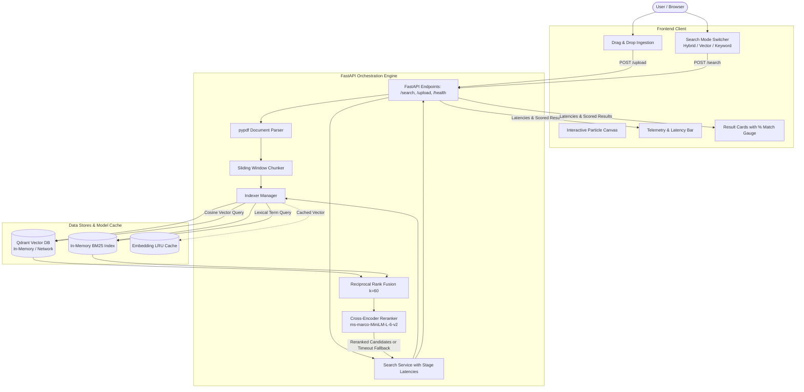

# System Architecture

## High-Level Overview

The Hybrid Search Engine is built as an end-to-end multi-modal ingestion and retrieval pipeline with a high-performance modern web interface.

```
[ User Browser / Client ] 
       ▲          │
       │ (JSON)   │ (HTTP / Multipart)
       ▼          ▼
[ FastAPI Orchestration Layer ]
   ├── Chunker (Sliding window overlap)
   ├── Indexer (Embedding generation & vector upsert)
   ├── First-Stage Retrieval (Dense + BM25)
   ├── Fusion (Reciprocal Rank Fusion - RRF)
   └── Second-Stage Reranking (Cross-Encoder with ThreadPool timeout)
```

---

### 1. Ingestion Pipeline
1. Documents arrive via `POST /ingest` (raw text payload) or `POST /upload` (PDF, TXT, MD, CSV, JSON).
2. **PDF Parser**: For PDF files, `pypdf` extracts text page-by-page.
3. **Chunker**: Splits text into fixed-size overlapping segments (e.g. 500 characters with 100 character overlap) to maintain semantic context across boundaries.
4. **Indexer**:
   - Computes Dense embeddings via SentenceTransformers (`all-MiniLM-L6-v2`, 384 dimensions).
   - Tokenizes chunk text for the sparse inverted index (BM25).
   - Upserts vectors and payload (chunk text + metadata) into Qdrant.
   - Appends tokenized documents into the in-memory BM25 model.

---

### 2. Retrieval Pipeline & Fusion Flow
1. Query arrives at `POST /search` with `query`, `search_mode` (`hybrid`, `vector`, `keyword`), and `top_k`.
2. **Dense Semantic Search**:
   - Query embedding is computed via `Indexer._encode_query` (cached via `@functools.lru_cache`).
   - Qdrant performs Approximate Nearest Neighbor (ANN) search with Cosine Similarity.
3. **Sparse Keyword Search**:
   - Query is tokenized and scored using `rank-bm25` (BM25Okapi).
4. **Reciprocal Rank Fusion (RRF)**:
   - Merges dense and sparse ranked candidate lists using:
     $$RRF\_Score(d) = \sum_{m \in \{dense, sparse\}} \frac{1}{k + rank_m(d)}$$
     *(Default $k = 60$)*.
5. **Cross-Encoder Reranking**:
   - Top candidates from first-stage retrieval are paired with the query: `[[query, doc_1], [query, doc_2], ...]`.
   - `cross-encoder/ms-marco-MiniLM-L-6-v2` performs joint cross-attention scoring.
   - Executed inside a `ThreadPoolExecutor` with a 2-second timeout for graceful degradation.
6. **Telemetry & Latency Tracking**:
   - Measures individual stage runtimes (`bm25_search_ms`, `dense_search_ms`, `rrf_merge_ms`, `cross_encoder_ms`, `total_ms`) and returns them in the response.

---

### 3. Frontend Presentation & Score Calibration
- **Sigmoid Calibration**: The Cross-Encoder produces raw classification logits $z \in (-\infty, +\infty)$ (e.g. `7.5331`). The frontend applies the logistic sigmoid function:
  $$P(\text{Relevance}) = \frac{1}{1 + e^{-z}}$$
  Logits like `7.5331` map accurately to probabilistic percentage matches (e.g., `99.9%`).
- **Telemetry Visualization**: Real-time breakdown bar visually represents milliseconds spent in BM25, Dense retrieval, RRF fusion, and Reranking.
- **Dynamic Background Canvas**: Lightweight 60 FPS interactive particle constellation interacting with mouse movements.

---

## Architecture Diagram



---

## Production Resilience & Optimizations

1. **Graceful ML Degradation**:
   - Heavy Cross-Encoder inference runs inside a thread pool with a strict 2-second timeout. If the server is under high concurrent load, the engine falls back to raw RRF candidates without failing the request.
2. **LRU Embedding Caching**:
   - Repeated user queries bypass neural model inference entirely using Python's `@functools.lru_cache`, returning pre-computed 384-dimensional vectors in sub-millisecond time.
3. **Non-Blocking Async Web Tier**:
   - FastAPI handles concurrent client requests asynchronously, mounting static assets with cache-busting version parameters to prevent stale browser caches.
