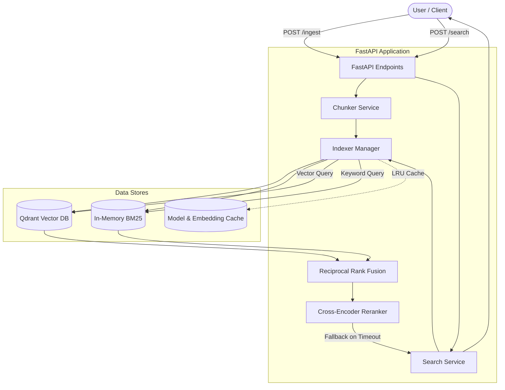

# System Architecture

## High-Level Overview

The Hybrid Search Engine acts as an ingestion and retrieval pipeline. 

### 1. Ingestion Flow
1. Documents arrive via `/ingest` or `/upload`.
2. **Chunker**: Splits raw text into fixed-size overlapping chunks.
3. **Indexer**:
   - Computes Dense embeddings via SentenceTransformers (`all-MiniLM-L6-v2`).
   - Tokenizes text for Sparse index (BM25).
   - Upserts vectors and payloads into Qdrant.
   - Appends text to the in-memory BM25 model.

### 2. Retrieval Flow (Hybrid Search)
1. Query arrives via `/search`.
2. **Dense Search**: Query is embedded and searched against Qdrant (Cosine Similarity).
3. **Sparse Search**: Query is tokenized and searched against the BM25 model.
4. **Fusion (RRF)**: Reciprocal Rank Fusion combines the ranked lists from both dense and sparse retrieval.
5. **Reranking**: The top-K fused candidates are passed to a Cross-Encoder (`cross-encoder/ms-marco-MiniLM-L-6-v2`) for contextual scoring.
6. **Response**: Final sorted chunks with itemized latencies are returned to the user.

---

## Architecture Diagram

## Production Enhancements

- **Resilience**: 
  - Cross-Encoder uses `concurrent.futures.ThreadPoolExecutor` with a configurable timeout. If the heavy ML model stalls under concurrent load, the system degrades gracefully by returning the RRF candidates without crashing.
- **Performance**:
  - `functools.lru_cache` wraps the dense query embedding function to prevent redundant GPU/CPU operations on repeated identical queries.
